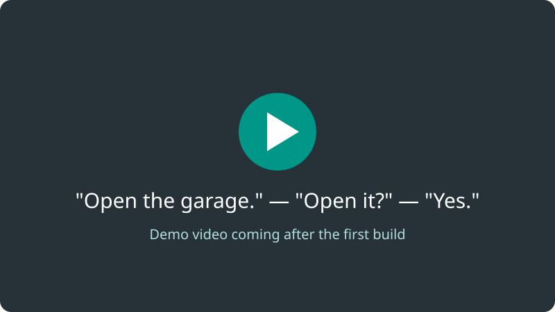

# garage-door

[](https://github.com/roykollensvendsen/garage-door/actions/workflows/checks.yml)
[](LICENSE)
[](https://roykollensvendsen.github.io/garage-door/)
[](docs/voice.md#try-it-without-a-garage)

**Talk to your garage door.** *"Open the garage." "The garage door is closed.
Open it?" "Yes."* An ESP32 joins a LiftMaster (Chamberlain) opener's
push-button terminals through an isolated relay, and a local MCP server lets
Claude ask before every press, report what the door did, and log it all.
Home network only. Build it in an evening for roughly €60–80, with no
soldering inside the opener.



- **Build one:** [build guide](docs/build-guide.md), with the schematic, the
  cable diagram and the parts by part number.
- **Does it work with your opener?** [Check, or add it](docs/compatibility.md),
  the easiest contribution there is.
- **Try it without a garage:** `uv run garage-door-mcp --simulate`
  ([how](docs/voice.md#try-it-without-a-garage)).
- **Read [Safety](docs/safety.md)** before you build.
- **Contribute:** [start here](docs/contribute.md). Coding agents: [AGENTS.md](AGENTS.md).

The project site, <https://roykollensvendsen.github.io/garage-door/>, goes
live when this repository is made public.

## Where this stands

Planning. The plan, with the opener's terminals traced to the manufacturer's
manual, the circuit, the parts list and the safety rules, is
[`docs/plan.md`](docs/plan.md). How to build it, with the schematic, the
cable diagram and the parts by part number, is
[`docs/build-guide.md`](docs/build-guide.md). Nothing has been bought, wired
or flashed.

## Safety

A press always takes a spoken yes, and nothing is pressed while the door is
moving, part-way or unknown. Closing by voice is allowed, but only from fully
open. The opener reverses on its own if the door meets something, exactly as
it does with the remote. If the door has not closed after the travel time,
the answer says so plainly ("did NOT close, possibly reversed") and nothing
is pressed again until someone has looked. Every press is logged with the
door's state before and after.

**Recommended later: photocells** (LiftMaster 771EV or similar on terminals 2
and 3). They stop and reverse a closing door before it touches anything,
rather than after. They are not required for this project.

## Updating the controller

The first build goes in over micro-USB. Every update after that goes over the
home Wi-Fi, is encrypted with its own key and works only from the LAN. The board keeps two
copies of its app and falls back to the last one that worked if an update
does not boot. The controller's log streams over the same encrypted
connection the laptop uses. USB stays the way back in if everything else
fails, so keep the socket reachable. Details are in
[`docs/plan.md`](docs/plan.md), section 3.

<!-- not run: needs the board, Wi-Fi and firmware/secrets.yaml -->
```bash
esphome run firmware/garage-door.yaml --device /dev/ttyUSB0   # first time, over USB
esphome run firmware/garage-door.yaml                         # afterwards, over Wi-Fi
esphome logs firmware/garage-door.yaml                        # the controller's log
```

**Working from elsewhere on the home network.** Everything below works
over Wi-Fi, without going to the controller:

- **Test mode.** After every boot and update it starts **not armed**. Presses
  are judged and logged, but the relay stays open. `garage-door arm` leaves
  test mode, only when the door may move; `garage-door disarm` goes back.
- **The log** shows every packet on the opener's data wire (terminals 0+2),
  as hex and decoded, under the tag `wire`.
- **Diagnostics:** Wi-Fi signal, uptime, firmware version, the reason for the
  last restart, and a restart button that does not touch the door.
- **A check from the laptop** that only reads (`arm` and `disarm` don't press either):

<!-- not run: needs the controller on the network -->
```text
$ GARAGE_DOOR_HOST=garage-door.local GARAGE_DOOR_API_KEY=... uv run garage-door check
Armed: off
Door state: closed
Firmware version: 2026.10.2 ...
Opener status on the wire: closed
Wi-Fi signal: -61
Not armed (test mode): presses are judged and logged, the relay stays open.
```

Without the controller's address and key, each of them refuses before it
connects to anything:

```console
$ env -u GARAGE_DOOR_HOST garage-door check
garage-door: GARAGE_DOOR_HOST is not set
$ env -u GARAGE_DOOR_HOST garage-door arm
garage-door: GARAGE_DOOR_HOST is not set
$ env -u GARAGE_DOOR_HOST garage-door disarm
garage-door: GARAGE_DOOR_HOST is not set
```

`sh scripts/esphome-config.sh compile` builds the firmware exactly as an
update would, with the example secrets, so a build is never first tried on
the controller.

## The gates

Every one of these runs in continuous integration, and all of them run here:

```console
$ uv run ruff check .
All checks passed!
```

<!-- not run: the workflow runs each of these; nesting them here would run the suite inside itself -->
```bash
uv run ruff format --check .   # layout
uv run mypy src                # types
uv run pytest -q               # behaviour
python scripts/mutate.py       # that each rule's own test can fail
sh scripts/firmware-tests.sh   # the controller's logic, on this machine
sh scripts/esphome-config.sh   # the controller's ESPHome configuration
```

`CONTRIBUTING.md` says what each one is for, and
[`decisions/`](decisions/README.md) records the choices that shaped them,
including how a change is made here.

## Licence

GPL-3.0-or-later. See [LICENSE](LICENSE). Each source file says so in an
`SPDX-License-Identifier` line near its top, and a test fails on a file without one.
