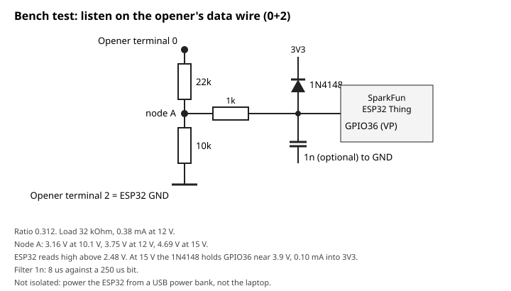
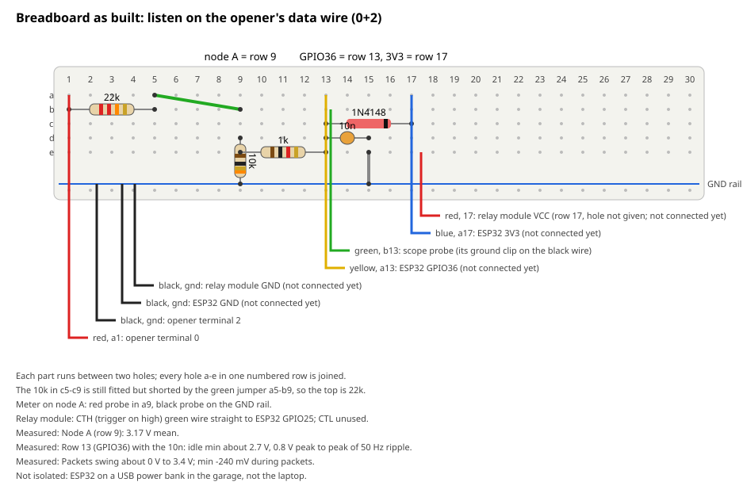
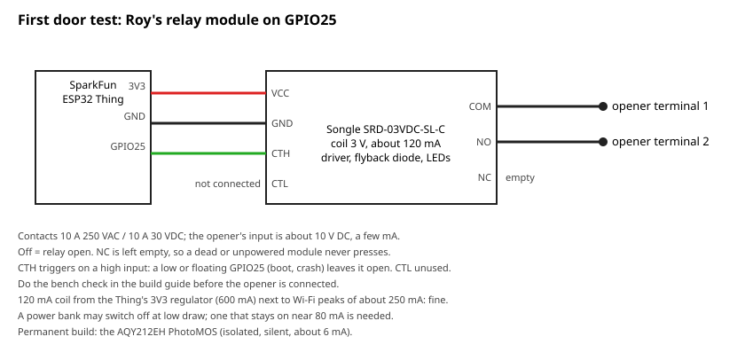

<!-- SPDX-License-Identifier: GPL-3.0-or-later -->
# Build guide

How to build the controller that lets a voice session open and close a
LiftMaster LM80EVF garage door. The pins, parts and wiring below are generated
from, or tested against, one file:
[`hardware/pins.toml`](https://github.com/roykollensvendsen/garage-door/blob/main/hardware/pins.toml). If this page and that file ever
disagree, the file wins and the tests fail.

## Safety first

- **Unplug the opener from the mains before opening any cover or touching its
  terminals.** The opener runs on 220–240 V. Its plug must stay reachable
  (manual 114A4C095B, PDF p. 20).
- **Leave the wire bridge between terminals 4 and 5 in place.** It stands in
  for a door-within-a-door contact. Without it, the opener will not run
  (manual PDF p. 22, section 26 A).
- **Connect to terminals 1 and 2 only.** They are the wall push-button input.
  Nothing else on the opener is touched (manual PDF p. 269, figure 19–20).
- **Nothing is soldered or changed inside the opener.** Two wires go into its
  push-in terminals, and that is all.
- **Test force reversal before relying on voice closing.** Lay a 50 mm
  obstacle flat under the door and close it. The door must reverse when it
  touches it (manual PDF p. 22, section 24). Repeat monthly.
- Photocells (LiftMaster 771EV or similar on terminals 2+3) are recommended:
  they stop a closing door before it touches anything. See
  [the decision record](https://github.com/roykollensvendsen/garage-door/blob/main/decisions/ADR-GD-002-close-without-photocells.md).

## What you need

| Qty | Part | Exact part or specification | Where it goes |
|---|---|---|---|
| 1 | Controller board | SparkFun ESP32 Thing, **DEV-13907** | the box |
| 2 | PhotoMOS relay (one spare) | Panasonic **AQY212EH** (DIP-4; 60 V, 0.5 A; AC/DC output) | U1 |
| 1 | DIP-4 socket | any 2.54 mm DIP-4 | under U1 |
| 1 | Resistor 330 Ω | 1/4 W | R1, relay LED |
| 1 | Screw terminal, 2-pin | 5 mm pitch | J2 (opener) |
| | Parts for listening on the data wire | see [the bench test](#bench-test-listening-on-the-openers-data-wire-02) below | terminals 0 and 2 to GPIO36 |
| 1 | Perfboard | about 50 × 70 mm, 2.54 mm pitch | the box |
| 1 | Pin headers | 2.54 mm, to solder onto the Thing | the box |
| 1 | Bell wire | 2-core, 0.5 mm², about 1 m | box to opener terminals 1 and 2 (W1) |
| 1 | Bell wire | 2-core, 0.5 mm², about 1 m | box to opener terminals 0 and 2 (data wire) |
| 1 | USB charger and cable | 5 V, 1 A, micro-USB | power |
| 1 | Enclosure | about 100 × 70 × 40 mm, two cable glands | mounted clear of the rail and chain |

The part references (U1, R1, …) are the ones in the schematic below.

There are no sensors on the door. The controller learns where the door is
from the opener itself: the opener reports open, closed, opening and
closing on its data wire (terminals 0 and 2), and the controller only
listens. Someone whose opener has no such wire can add two reed contacts:
the controller's logic still supports them (`DoorLogic::update` in
`firmware/door_logic/door_logic.h`, with its tests), and GPIO34 and GPIO35
are free for them.

## The circuit


Also as [PDF](wiring/schematic.pdf). The source is
[`hardware/garage-door.kicad_sch`](https://github.com/roykollensvendsen/garage-door/blob/main/hardware/garage-door.kicad_sch). It
opens in KiCad 10, and is generated by `scripts/schematic.py`, so edit
`hardware/pins.toml` rather than the drawing.

In words, for anyone who cannot see the picture:

- **Pressing the button.** GPIO25 → R1 (330 Ω) → relay U1 pin 1 (LED
  anode). U1 pin 2 → GND. U1's output, pins 3 and 4, goes to box terminal J2.
  From there it goes to opener terminals 1 and 2. The output is isolated from
  the board, so either wire can go to either terminal.
- **Listening on the data wire.** Not in this schematic yet: for now it is
  the divider in [the bench test](#bench-test-listening-on-the-openers-data-wire-02)
  below, terminal 0 through 22 kΩ and 10 kΩ to GPIO36, with ground on
  terminal 2. An isolated input is planned
  ([drawing](wiring/opto-input-schematic.svg)).
- **Power.** USB into the Thing's micro-USB socket. The Thing's own 3V3 and
  GND feed the relay LED.

## The cables


Source: [`hardware/harness.yaml`](https://github.com/roykollensvendsen/garage-door/blob/main/hardware/harness.yaml), rendered with
WireViz.

| From (box) | Wire | To |
|---|---|---|
| J2 pin 1 (OPENER_1) | W1 white | LiftMaster terminal **1** |
| J2 pin 2 (OPENER_2) | W1 red | LiftMaster terminal **2** |

The data wire, terminals 0 and 2, is wired as the bench test below shows.

## Bench test: listening on the opener's data wire (0+2)

A first, listen-only test on a breadboard, before anything is soldered. It
lets the controller hear the opener's own status messages (see the plan,
"First bench test"). It is **not isolated**: it joins the ESP32's ground to
terminal 2, so power the ESP32 from a USB power bank in the garage, not
from the laptop.

| Qty | Part | Where it goes |
|---|---|---|
| 1 | Resistor 22 kΩ | terminal 0 to node A |
| 1 | Resistor 10 kΩ | node A to ground |
| 1 | Resistor 1 kΩ | node A to GPIO36 |
| 1 | Diode 1N4148 for this test; a Schottky (1N5819, BAT85) for a permanent build | GPIO36 to 3V3, band (cathode) at 3V3 |
| 1 | Capacitor 1 nF (102), ceramic | GPIO36 to ground; not 10 nF, which would round the bits off |
| | Breadboard and jumper wires | |

Roy first tried 22 kΩ + 10 kΩ over 10 kΩ. Node A then read only 2.4 V,
too close to the ESP32's threshold, so the top is 22 kΩ alone.



In words: terminal 0 → 22 kΩ → node A → 10 kΩ → terminal 2, which is
also the ESP32's GND. Node A → 1 kΩ → GPIO36 (marked VP on some boards).
The diode runs from GPIO36 up to 3V3, band towards 3V3.



**As built by Roy (2026-11-04)**, on a half-size breadboard: rows 1–30,
holes a–e of each row joined, and the blue rail beside them as ground.

| Part | Holes | Net |
|---|---|---|
| red wire from opener terminal 0 | a1 | line |
| 22 kΩ | b1–b5 | line to row 5 |
| green jumper that shorts it | a5–b9 | so the top is 22 kΩ alone |
| 10 kΩ | d9 to the rail | node A (row 9) to ground |
| black wire from opener terminal 2 | rail | ground |
| 1 kΩ | e9–e13 | node A to GPIO36 (row 13) |
| 1N4148, black stripe at c17 | c13–c17 | GPIO36 to 3V3 (row 17) |
| 10 nF ceramic (103) | d13–d15 | GPIO36 to row 15 |
| wire | e15 to the rail | so the 10 nF is GPIO36 to ground |
| green scope probe wire | b13 | ground clip on the black wire |
| yellow wire to ESP32 GPIO36 | a13 | not connected yet |
| red wire to the relay module's VCC | row 17 | 3V3; not connected yet |
| black wire to the relay module's GND | rail | not connected yet |
| blue wire to ESP32 3V3 | a17 | not connected yet |
| black wire to ESP32 GND | rail | not connected yet |

Roy measured on the scope:
- node A: 3.17 V mean;
- row 13, with the 10 nF: about 2.7 V minimum while idle, with about 0.8 V
  peak to peak of 50 Hz ripple;
- packets swing from about 0 V to 3.4 V, with a minimum of −240 mV.

To measure node A, put the red probe in a9 and the black probe on the rail.
Colour bands: 22 kΩ red-red-orange-gold, 10 kΩ brown-black-orange-gold,
1 kΩ brown-black-red-gold (5 %). The ESP32 Thing still needs its headers.
It runs from a USB power bank in the garage.

1. **Opener unplugged.** Measure each resistor on the ohms range.
2. **Divider only, ESP32 off the board.** Wire terminal 0 and terminal 2 to
   the divider through the orange levers. Plug the opener in.
3. **Measure 0 to 2** on DC volts: still about 11–12 V, as without the
   divider. A drop of more than about 0.1 V means the divider loads the
   line too much.
4. **Measure node A to terminal 2:** about 3.2 V mean while idle (Roy
   measured 3.17 V). Run the door once from the remote. Node A must never be
   negative. Above about 11.5 V on the line the diode holds GPIO36 near 3.9 V.
5. **Only then** add the 1 kΩ, the diode and the wire to GPIO36, and join the
   ESP32's GND to terminal 2. The controller logs every packet under the tag
   `wire` (`esphome logs firmware/garage-door.yaml`).

## First door test: Roy's relay module

For the first test on the door, Roy uses a relay module he already has
instead of the AQY212EH. The PhotoMOS stays the part for the permanent build:
it is isolated, silent and draws about 6 mA.



The module is a red board with a Songle SRD-03VDC-SL-C relay. The coil is 3 V
and draws about 120 mA. The contacts are rated 10 A at 250 V AC or 30 V DC.
The board has its own driver transistor, flyback diode and LEDs.
- **Input terminal (left to right VCC, GND, CTH, CTL):** CTH triggers on a
  high input, CTL on a low one. **CTH is used**, so a low or floating GPIO25
  (at boot, after a crash or a reset) leaves the relay open; CTL stays
  empty. The firmware keeps `relay_active_low: "false"`, and the controller
  starts unarmed after every boot. Planned wires: relay VCC to breadboard
  row 17 (the 3V3 net, red), relay GND to the blue rail (black), relay CTH
  straight to ESP32 GPIO25 (green). Not connected yet: the ESP32 still needs
  headers and firmware.
- **Output terminal:** COM is the middle screw and NO the right one
  (measured, see below). COM to opener terminal 1, NO to terminal 2. NC stays empty, so a dead or unpowered module never presses.
- **Power:** the coil's 120 mA comes from the Thing's 3.3 V regulator (rated
  600 mA), next to the ESP32's Wi-Fi peaks of about 250 mA. That fits. Some
  power banks switch off when little is drawn; use one that stays on at about
  80 mA, and watch that it does not cut out when the relay clicks.

### Bench check, with the opener disconnected

1. **Nothing on NO and COM** but a multimeter on continuity (beep).
2. **Power only:** VCC and GND connected, CTH and CTL unconnected. The relay
   must not click, its LED must stay off, and the meter must stay silent. If
   it clicks on its own, stop.
3. **CTH to 3V3** with a wire: it clicks and the meter beeps. **CTH to GND**:
   it stays open. If not, the labels are not what they seem; stop and note
   what it does.
4. Wire CTH to GPIO25 and flash, with the controller **unarmed**. Watch the
   LED and the meter through power-up, a restart from the laptop, and
   unplugging and plugging the power bank. It must never click. GPIO25 is
   not a strapping pin; it floats from reset until ESPHome drives it low,
   and CTH reads floating as off (step 2).
5. Arm it (`garage-door arm`) and press once by voice. The meter beeps for
   half a second, once. Then disarm.

Only then wire COM and NO to opener terminals 1 and 2.

**Roy's bench results (2026-11-04),** with the ESP32 Thing wired straight
to the module (VCC to 3V3, GND to GND, CTH to GPIO25) and nothing on its
output:
- CTH touched to 3V3 clicks the relay: the input triggers on high, as its
  label says.
- Flashed over USB with ESPHome 2026.10.2. It joined Wi-Fi at about −55 dB
  at the desk (−63 dB on the next check).
- The relay did not click at power-up, after flashing, or on the RST
  button.
- `garage-door check` over Wi-Fi reported: not armed, door state **fault**.
  (The firmware then read reed contacts; it no longer does.) With none
  fitted, GPIO34 and GPIO35 float and both read
  "on"; both ends at once is a fault, so every press is refused. That is the
  intended fail-closed answer, not a bug. Fit the pull-ups or tie the pins
  (GPIO34 to GND, GPIO35 to 3V3 through 10 kΩ) before a press test.
- Last restart reason: "other watchdogs" (`RTCWDT_RTC_RESET`). The serial
  log shows it straight after a power-on reset, from the USB adapter
  resetting the chip. The firmware then ran with no panic or watchdog
  message. It is a real problem only if it shows up later without anyone
  touching the board, with the uptime starting again from zero.
- With "closed" faked (GPIO34 to GND, GPIO35 through 10 kΩ to 3V3), the
  door read **closed**. Armed, two "open" requests by voice, each confirmed
  with a spoken yes, were accepted by the controller, and the relay
  **clicked** (Roy, about 23:00). The service answered "pressed, but the
  door did not reach open: it is closed". That is right on the bench, with
  nothing on the relay's output and the reed inputs held by wires.
- Found on the way: the first request after the laptop connected always
  read "unknown", because the door was read before the controller's first
  report arrived. Fixed on the laptop, with a test; the controller was fine.

**Relay output, checked in the garage (2026-11-05),** with the output still
not connected to the opener and the controller unarmed:
- Continuity puts **COM on the middle screw and NO on the right one**. NO
  is open at rest (the meter shows OL).
- CTH bridged to VCC by hand: the relay clicks and the meter beeps across
  COM and NO.
- Then wired to the opener: COM (middle) to terminal 1, NO (right) to
  terminal 2, with two blue wires.
- **Boot check on the real opener:** Roy power-cycled the ESP32. The door
  did not move and the relay did not click. `garage-door check` afterwards
  reported Armed off and Manual mode off.
- **Bad jumper wires (2026-11-05, about 10:10).** Three manual presses
  (09:41, 09:47, 09:49) were accepted by the controller, but the door did
  not move. Roy found several blue jumper wires with no continuity: bad
  crimps. He replaced the relay's output wires (COM to terminal 1, NO to
  terminal 2) with proper wire, continuity-checked every wire on the bus
  side (red 0 to a1, black 2 to the rail, yellow a13 to GPIO36, black rail
  to ESP32 GND, green jumper a5 to b9), and took out the shorted 10 kΩ at
  c5–c9. **Check every jumper wire for continuity before you trust it.**
- **First press through the relay that moved the door (2026-11-05,
  10:38:38).** Manual mode, armed, after a spoken yes: the door went from
  fully open to closed, as the wall button does. The opener sent a packet
  about a second later and another about 20 s later, at the end of travel.
  (A press at 10:15 after the rewiring most likely moved it too; Roy did
  not say.)
- **First "open" by name (11:11:51),** with the state from the opener's
  wire (ADR-GD-005) and no manual mode. The controller read "closed" from
  the opener's 5-minute status. The service asked "The garage door is
  closed. Open it?", Roy said yes, and the opener reported opening at once
  and open about 18 s later. The service answered "Pressed. The garage door
  was closed and is now open."
- **First open and close by voice (14:33 and 14:35),** from the Claude app,
  through the claude-voice bridge to this MCP server, against the real door.
  For "open", the question came at 14:33:08 and Roy's spoken yes at 14:33:32.
  The opener reported opening at once and open at 14:33:50, and the answer
  was "closed → open, reached". Roy confirmed it at the door. "Close"
  followed: the question came at 14:35:21, the yes at 14:35:32, and the door
  was closed at 14:35:52. Each was one press, logged with requester "mcp".

## First press on the real door: manual mode

Until the opener's data wire says where the door is, every ordinary press
is refused. Manual mode allows one kind of press
anyway, while you stand at the door and watch it
([ADR-GD-004](https://github.com/roykollensvendsen/garage-door/blob/main/decisions/ADR-GD-004-manual-press.md)).

1. **Check that the door state reads unknown** before the relay goes near
   the opener, never closed or open, if nothing is connected to 0 and 2.
2. Wire the relay's COM and NO to opener terminals 1 and 2, as above.
3. Stand where you can see the whole door, with nobody in the doorway.
4. `garage-door arm`, then `garage-door manual on`. Manual mode switches
   itself off after 10 minutes, and is off after every restart.
5. Ask Claude to "press the garage button". It asks "Only say yes if you
   can see the door". Answer yes only while you can see it. It says
   "Pressed" and nothing about which way the door went: a press may open,
   stop or close it, as the wall button does.
6. `garage-door manual off` and `garage-door disarm` when you are done.

Open and close by name stay refused until the door's state is known.

## Step by step

1. **Measure first** (opener plugged in, door clear, a meter on DC volts).
   Probe tips do not reach the contacts of the push-in terminals: press the
   orange lever, insert a short wire, and measure on the wire. Measure between
   terminals 1 and 2 and note it. It must be below 60 V for the AQY212EH; on
   the LM80EVF it is about 10 V. Then unplug the opener.
2. **Check the input by hand.** With the opener plugged in again, join the
   wires from 1 and 2 for about half a second. One press steps the door:
   from closed it opens, the next press stops it, the next closes it. That
   is why the controller only presses when it knows the door is fully open
   or fully closed.
3. **Solder the headers** onto the ESP32 Thing.
4. **Build the board** as the schematic shows: the relay in its socket, R1
   and the screw terminal. Add the data-wire divider from the bench test.
5. **Test on the desk** before going near the opener. Put an LED and a 1 kΩ
   resistor in series across J2, with a 3 V coin cell as the source. It should
   light for half a second when the controller presses. "Door state" reads
   unknown, since nothing is heard yet.
6. **Flash the firmware over USB** the first time (see the README, "Updating
   the controller"). Later updates go over Wi-Fi.
7. **Unplug the opener.** Run W1 to terminals 1 and 2, and the data wire to
   terminals 0 and 2, and push the wires in. Check that the 4–5 bridge is
   untouched. Plug the opener back in.
8. **Check that the door state is read.** Use the remote once; "Door state"
   should follow it (open, closed), and `garage-door check` reports it.
9. **Run the reversal test** (50 mm obstacle, see above). Then try "open the
   garage" and "close the garage" with the door in view.

Photos of each step will be added after the first build.

## Magic phrases (optional)

By default, every open and close asks a question and waits for your yes.
To open or close with one sentence, write your own phrases, in any
language you speak to the voice, in `~/.config/garage-door/phrases.toml`.
Then make it readable by you only, and restart the voice bridge:

```toml
[nb]
open = ["sesam, lukk deg opp"]
close = ["sesam, lukk deg igjen"]

[en]
open = ["open sesame now"]
close = ["close sesame now"]

[de]
open = ["Sesam, öffne dich"]
close = ["Sesam, schließ dich"]
```

```sh
chmod 600 ~/.config/garage-door/phrases.toml
```

Saying "sesam, lukk deg opp, åpne garasjedøra" then opens the door
straight away. Every other rule still applies: the door's state must be
known, the controller armed, and closing allowed. How it matches:

- Case, commas, spacing and accents don't matter.
- A word said twice counts once, because speech recognition often drops
  the repeat.
- One letter wrong, missing or extra is forgiven in the whole phrase, in a
  word of five letters or more.
- The words must all be there, in order. The phrase is not translated:
  list each one you will say.

Choose words you never say otherwise, because there is no length limit.
The phrases are a convenience setting, not a secret: your phone's speech
recognition and the voice model both see them. They are kept outside git by
default because they are yours, not the project's. The log records that a phrase was used,
never which one. Without the file, nothing changes. Background:
[ADR-GD-008](https://github.com/roykollensvendsen/garage-door/blob/main/decisions/ADR-GD-008-magic-phrases.md).
