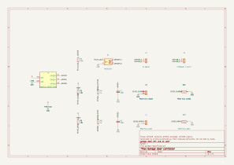
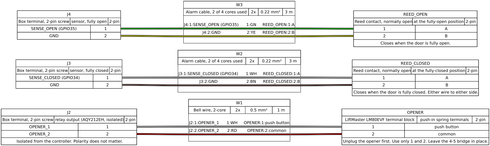

<!-- SPDX-License-Identifier: GPL-3.0-or-later -->
# Build guide

How to build the controller that lets a voice session open and close a
LiftMaster LM80EVF garage door. The pins, parts and wiring below are generated
from, or tested against, one file:
[`hardware/pins.toml`](https://github.com/roykollensvendsen/garage-door/blob/main/hardware/pins.toml). If this page and that file ever
disagree, the file wins and the tests fail.

## Safety first

- **Unplug the opener from the mains before opening any cover or touching its
  terminals.** The opener runs on 220–240 V. Its plug must stay reachable
  (manual 114A4C095B, PDF p. 20).
- **Leave the wire bridge between terminals 4 and 5 in place.** It stands in
  for a door-within-a-door contact. Without it, the opener will not run
  (manual PDF p. 22, section 26 A).
- **Connect to terminals 1 and 2 only.** They are the wall push-button input.
  Nothing else on the opener is touched (manual PDF p. 269, figure 19–20).
- **Nothing is soldered or changed inside the opener.** Two wires go into its
  push-in terminals, and that is all.
- **Test force reversal before relying on voice closing.** Lay a 50 mm
  obstacle flat under the door and close it. The door must reverse when it
  touches it (manual PDF p. 22, section 24). Repeat monthly.
- Photocells (LiftMaster 771EV or similar on terminals 2+3) are recommended:
  they stop a closing door before it touches anything. See
  [the decision record](https://github.com/roykollensvendsen/garage-door/blob/main/decisions/ADR-GD-002-close-without-photocells.md).

## What you need

| Qty | Part | Exact part or specification | Where it goes |
|---|---|---|---|
| 1 | Controller board | SparkFun ESP32 Thing, **DEV-13907** | the box |
| 2 | PhotoMOS relay (one spare) | Panasonic **AQY212EH** (DIP-4; 60 V, 0.5 A; AC/DC output) | U1 |
| 1 | DIP-4 socket | any 2.54 mm DIP-4 | under U1 |
| 1 | Resistor 330 Ω | 1/4 W | R1, relay LED |
| 2 | Resistor 10 kΩ | 1/4 W | R2, R3, sensor pull-ups |
| 2 | Resistor 1 kΩ | 1/4 W | R4, R5, sensor input protection |
| 2 | Capacitor 100 nF | ceramic, ≥ 16 V | C1, C2, sensor filters |
| 3 | Screw terminal, 2-pin | 5 mm pitch | J2 (opener), J3, J4 (sensors) |
| 1 | Perfboard | about 50 × 70 mm, 2.54 mm pitch | the box |
| 1 | Pin headers | 2.54 mm, to solder onto the Thing | the box |
| 2 | Reed contact with magnet | normally open, closes when the magnet is near; a heavy-duty or floor-mount one for the closed position | the door |
| 1 | Bell wire | 2-core, 0.5 mm², about 1 m | box to opener (W1) |
| 1 | Alarm cable | 4-core, 0.22 mm², about 10 m | box to sensors (W2, W3) |
| 1 | USB charger and cable | 5 V, 1 A, micro-USB | power |
| 1 | Enclosure | about 100 × 70 × 40 mm, two cable glands | mounted clear of the rail and chain |

The part references (U1, R1, …) are the ones in the schematic below.

## The circuit

Also as [PDF](wiring/schematic.pdf). The source is
[`hardware/garage-door.kicad_sch`](https://github.com/roykollensvendsen/garage-door/blob/main/hardware/garage-door.kicad_sch). It
opens in KiCad 10, and is generated by `scripts/schematic.py`, so edit
`hardware/pins.toml` rather than the drawing.

In words, for anyone who cannot see the picture:

- **Pressing the button.** GPIO25 → R1 (330 Ω) → relay U1 pin 1 (LED
  anode). U1 pin 2 → GND. U1's output, pins 3 and 4, goes to box terminal J2.
  From there it goes to opener terminals 1 and 2. The output is isolated from
  the board, so either wire can go to either terminal.
- **Fully-closed sensor.** 3V3 → R2 (10 kΩ) → node SENSE_CLOSED. Box terminal
  J3 pin 1 is the reed contact; J3 pin 2 is GND. SENSE_CLOSED → R4 (1 kΩ) →
  GPIO34, with C1 (100 nF) from GPIO34 to GND.
- **Fully-open sensor.** The same, with R3, R5, C2, J4 and GPIO35.
- **Power.** USB into the Thing's micro-USB socket. The Thing's own 3V3 and
  GND feed the pull-ups and the relay LED.

## The cables

Source: [`hardware/harness.yaml`](https://github.com/roykollensvendsen/garage-door/blob/main/hardware/harness.yaml), rendered with
WireViz.

| From (box) | Wire | To |
|---|---|---|
| J2 pin 1 (OPENER_1) | W1 white | LiftMaster terminal **1** |
| J2 pin 2 (OPENER_2) | W1 red | LiftMaster terminal **2** |
| J3 pin 1 (SENSE_CLOSED, GPIO34) | W2 white | fully-closed reed, either side |
| J3 pin 2 (GND) | W2 brown | fully-closed reed, other side |
| J4 pin 1 (SENSE_OPEN, GPIO35) | W3 green | fully-open reed, either side |
| J4 pin 2 (GND) | W3 yellow | fully-open reed, other side |

## Step by step

1. **Measure first** (opener plugged in, door clear, a meter on DC volts).
   Probe tips do not reach the contacts of the push-in terminals: press the
   orange lever, insert a short wire, and measure on the wire. Measure between
   terminals 1 and 2 and note it. It must be below 60 V for the AQY212EH; on
   the LM80EVF it is about 10 V. Then unplug the opener.
2. **Check the input by hand.** With the opener plugged in again, join the
   wires from 1 and 2 for about half a second. One press steps the door:
   from closed it opens, the next press stops it, the next closes it. That
   is why the controller only presses when it knows the door is fully open
   or fully closed.
3. **Solder the headers** onto the ESP32 Thing.
4. **Build the board** as the schematic shows: the relay in its socket, the
   five resistors, the two capacitors and the three screw terminals.
5. **Test on the desk** before going near the opener. Put an LED and a 1 kΩ
   resistor in series across J2, with a 3 V coin cell as the source. It should
   light for half a second when the controller presses. Close a wire across
   J3 and across J4, and watch "Door state" change.
6. **Flash the firmware over USB** the first time (see the README, "Updating
   the controller"). Later updates go over Wi-Fi.
7. **Mount the reed contacts.** One where the door rests fully closed, one
   where it rests fully open, each with its magnet on the moving part, about
   10 mm apart when the door is at that end.
8. **Unplug the opener.** Run W1 to terminals 1 and 2 and push the wires in.
   Check that the 4–5 bridge is untouched. Plug the opener back in.
9. **Run the reversal test** (50 mm obstacle, see above). Then try "open the
   garage" and "close the garage" with the door in view.

Photos of each step will be added after the first build.
