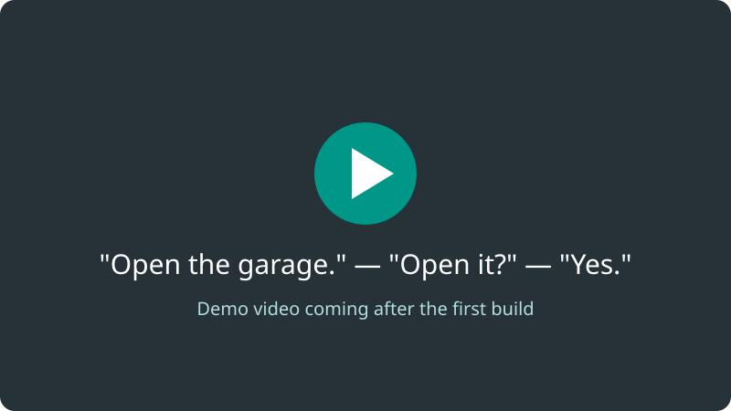

<!-- SPDX-License-Identifier: GPL-3.0-or-later -->

# Talk to your garage door

*"Open the garage." "The garage door is closed. Do you want me to open it?" "Yes."* And it opens.

**garage-door** is a small controller box and a few hundred lines of code that
let a voice assistant open and close a LiftMaster (Chamberlain) garage door.
It asks before every press, says what the door did afterwards, and never
leaves your home network.

<figure markdown>
  
  <figcaption>Demo video coming after the first build. Until then, the
  <a href="voice/#try-it-without-a-garage">simulated door</a> shows the whole
  conversation on your own computer.</figcaption>
</figure>

[Build one](build-guide.md){ .md-button .md-button--primary }
[Does it work with my opener?](compatibility.md){ .md-button }
[Contribute](contribute.md){ .md-button }

## Build it in an evening

| You need | How much |
|---|---|
| **Time** | About 3–4 hours: an hour to build the box, an hour to flash it and mount the sensors, the rest for testing. |
| **Cost** | Roughly €60–80 in parts (see below). |
| **Skills** | Soldering a few parts onto perfboard. **No soldering inside the opener**: two wires go into its push-button terminals. |
| **Tools** | Soldering iron, multimeter, small screwdriver, drill for the sensor brackets. |

Rough prices, November 2026, from typical hobby shops. They are estimates,
not quotes:

| Part | About |
|---|---|
| SparkFun ESP32 Thing | €25 |
| Panasonic AQY212EH relay (×2), resistors, capacitors, terminals, perfboard | €10 |
| Two reed contacts with magnets | €10–20 |
| Bell wire and alarm cable | €8 |
| Enclosure, USB charger and cable | €12 |

## How it works

1. You speak to a voice session (Claude, through the MCP tools in this repo).
2. It asks the controller on your network what the door is doing. It reads
   two magnetic contacts: one at fully closed, one at fully open.
3. It reads you a question: "The garage door is closed. Do you want me to open it?"
4. Only after a clear yes does the controller close an isolated relay across
   the opener's push-button terminals for half a second, as the wall button does.
5. After the door's travel time it tells you where the door ended up, or warns
   you plainly if a closing door did not close.

Every request and press is logged. If the door's state is not known, nothing
is pressed. The opener's own safety features (force reversal, photocells) are
not touched.

## Why

- Your hands are full, or you are in the car, and the remote is somewhere else.
- You want to ask "is the garage closed?" from bed and get an honest answer.
- You want home automation without a cloud account or an app that can stop
  working when a company changes its mind. Nothing here leaves your network.

## What it works with

Built for the **LiftMaster LM80EVF**, and expected to work with its siblings
LM60EVF, LM100EVF and LM130EVF (same manual and terminals). Many other
openers have the same kind of push-button input.
[Check yours, or add it.](compatibility.md)

## Safety, honestly

A garage door is heavy and can hurt people. Closing by voice means closing a
door you may not be looking at, which the opener's manual advises against.
This project allows it only from fully open, only after a spoken yes, and tells
you if the door did not close. It strongly recommends photocells.
[Read the safety page](safety.md) before you build.

<small>LiftMaster and Chamberlain are trademarks of The Chamberlain Group. This
project is not affiliated with or endorsed by them.</small>
